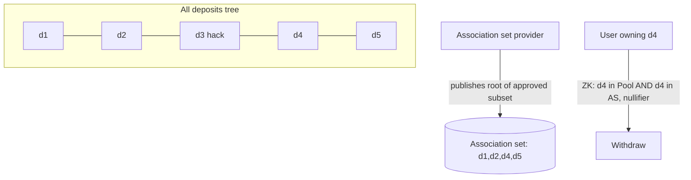

# Privacy Pools and Association Sets

A plain mixer gives every withdrawal the same anonymity set: everyone who deposited. That is good for privacy and bad for honest users when stolen funds are in the pool, because nobody can tell their withdrawal apart from a thief's. Privacy Pools is a design that lets a user prove one more thing in zero knowledge: that their deposit belongs to a chosen subset of deposits, an **association set**, without revealing which one.

## The idea

The design is set out in "Blockchain Privacy and Regulatory Compliance: Towards a Practical Equilibrium" by Vitalik Buterin, Jacob Illum, Matthias Nadler, Fabian Schär and Ameen Soleimani (2023). In outline:

1. Deposits go into a pool as in a mixer, building a Merkle tree of all commitments.
2. Someone publishes an association set: a Merkle root over a subset of deposits, for example "all deposits not linked to known hacks".
3. On withdrawal, the user proves membership in the full deposit tree **and** in the association set, plus the usual nullifier.
4. Observers learn only that the withdrawal comes from some deposit in the association set.

The paper discusses **inclusion** proofs (I belong to this good set) and **exclusion** proofs (I am not in this bad set), and argues inclusion is generally more robust because new bad deposits can be found after the fact.



## Association set providers

Who builds the sets? The paper leaves this open; deployed versions use an **association set provider (ASP)**. In 0xbow's Privacy Pools deployment on Ethereum (launched in 2025), per its documentation, an ASP reviews deposits and only approved deposits can be withdrawn privately; deposits that are not approved can still be withdrawn publicly by the original depositor ("ragequit"). Check the current docs for exact rules.

Security questions for any ASP model:

| Question | Why it matters |
|---|---|
| Who can update the association root, and how? | A compromised ASP key could approve a thief's deposit or exclude honest users |
| Is the set built from public, reproducible criteria? | Users and auditors should be able to recompute it |
| What if the ASP stops working? | Users must have an exit (public withdrawal) that does not depend on the ASP |
| Can there be several ASPs? | Competition and choice reduce single-operator risk |
| Does the ASP learn anything private? | Ideally it sees only public deposit data |
| How quickly can a later-discovered bad deposit be removed? | Approved sets must be updatable without breaking honest withdrawals in flight |

## Circuit and contract changes

Compared with a mixer, a privacy pool adds:

- A second Merkle membership proof against the association root, with the **same leaf** as the pool proof. If the two proofs could use different leaves, a thief could prove pool membership with their own deposit and association membership with someone else's.
- A check in the contract that the association root is a current or recently valid root published by an authorised ASP.
- Often, variable amounts: commitments include a value, and partial withdrawals create a new commitment for the remainder ("change"). That adds value-conservation constraints and range checks.

```circom
// Sketch: both membership proofs must use the same leaf
component poolProof = MerkleProof(DEPTH);
component aspProof  = MerkleProof(ASP_DEPTH);
poolProof.leaf <== commitment;
aspProof.leaf  <== label;          // label derived from the same deposit
poolProof.root === poolRoot;       // public input
aspProof.root  === associationRoot; // public input
```

Here `label` must be derived deterministically from the same deposit as `commitment`, and the circuit must constrain that relation.

## Variable amounts and change

With variable amounts:

- `withdrawn + newValue == oldValue` must be enforced in the circuit.
- Every value must be range-checked (for example, < 2^128) to stop field wrap-around, where a "negative" value appears as a huge field element.
- The new commitment for the change must be inserted into the tree, and the old nullifier spent, atomically.

Missing range checks have caused serious bugs in other ZK systems, and the same class applies here.

## Trade-offs

Privacy Pools improves honest users' position but does not remove trade-offs:

- Anonymity sets shrink to the association set, and further if several ASPs with different sets are used.
- An ASP becomes a policy chokepoint: what it approves is a policy choice, not a cryptographic fact.
- Late discovery: a deposit approved today might be linked to a hack tomorrow. Users who withdrew in between still have proofs against the old root.

## Worked example

_Not executed in this book's CI; verify locally._

Extend the chapter 1 circuit into a toy privacy pool with an association set, locally.

1. Write a circom `MerkleProof(depth)` template using Poseidon (or reuse a vetted one from circomlib-compatible libraries), with path indices constrained to be bits (`b * (b - 1) === 0`).
2. Build `Withdraw.circom` with: private `nullifier`, `secret`, two path arrays; public `poolRoot`, `associationRoot`, `nullifierHash`, `recipient`. Constrain both proofs to the same leaf.
3. Generate a local test setup with snarkjs, and export a Solidity verifier with `snarkjs zkey export solidityverifier`.
4. Write a Foundry `ToyPrivacyPool` that stores pool roots, accepts association roots only from an `asp` address, and verifies proofs.
5. Tests: honest withdrawal succeeds; withdrawal for a deposit not in the association set fails; a proof that uses a different leaf for each tree cannot be generated (try it: the witness generator should fail on the constraint).
6. Add a `ragequit` path for the original depositor and test it works when the ASP is offline.

## Common pitfalls

- Allowing the two membership proofs to use different leaves.
- ASP root updates controlled by one hot key with no history.
- No public exit when the ASP stops approving.
- Missing range checks on variable amounts.
- Presenting ASP approval as proof of innocence rather than a policy decision.

## Exercises

1. Write a Python script that builds an association set root from a list of deposits minus a list of flagged deposits, so anyone can reproduce an ASP's root.
2. Remove the bit constraint on path indices in your `MerkleProof` and find an input that proves membership of a value not in the tree.
3. Compare the anonymity set of a withdrawal under one ASP with 80% of deposits approved versus two ASPs with different 80% sets, assuming users pick one.

## Further reading

- Buterin, Illum, Nadler, Schär, Soleimani, "Blockchain Privacy and Regulatory Compliance: Towards a Practical Equilibrium", 2023 (SSRN; also published in Blockchain: Research and Applications, 2024)
- 0xbow Privacy Pools documentation and contracts (search "0xbow privacy pools"; verify the official source)
- circom documentation: <https://docs.circom.io>
- **zk-circuit-security** in this wiki
