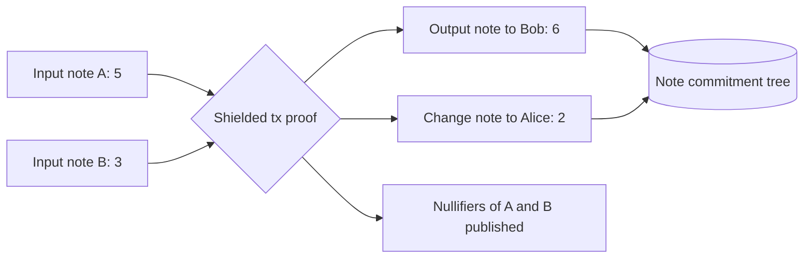

# Shielded Pools and Viewing Keys

A mixer hides the link between one deposit and one withdrawal. A shielded pool goes further: inside the pool, users send arbitrary amounts to each other, and observers see neither sender, receiver nor amount. Zcash pioneered this design in production; Railgun and Aztec bring related ideas to Ethereum. Shielded pools also introduce **viewing keys**, which let a user reveal their activity to chosen parties. This chapter covers the note model, the soundness checks it needs, and the security of viewing keys.

## The note model

Value inside a shielded pool lives in **notes**. A note records an owner (a public key or address derived from a spending key), a value, and randomness. Each note has:

- a **note commitment**, added to a global Merkle tree when the note is created;
- a **nullifier**, derived from the note and the owner's secret key, published when the note is spent.

A shielded transaction consumes some notes and creates others. Its proof shows, without revealing which notes:

1. each input note commitment is in the tree (membership against a recent root);
2. the spender knows the key that owns each input note;
3. each published nullifier is correctly derived from its input note;
4. total input value equals total output value plus any public value leaving the pool (and fees);
5. every value is in range (no negative values through field wrap-around).

## Zcash and Aztec, briefly

| Aspect | Zcash (per protocol spec) | Aztec (per docs) |
|---|---|---|
| Deployment | Own chain; shielded pools Sprout, Sapling (2018), Orchard (2022, Halo 2, no trusted setup) | Privacy-focused L2 on Ethereum; earlier product Aztec Connect was shut down |
| Notes | Note commitments in per-pool trees; nullifiers in a global set | Private notes and nullifiers, plus public state |
| Proof system | Groth16 (Sapling), Halo 2 (Orchard) | PLONK-family proofs; contracts written in Noir |
| Key hierarchy | Spending key → full viewing key → incoming viewing key | Separate keys for spending and viewing (nullifier and incoming viewing keys in docs) |

Read the Zcash protocol specification and Aztec documentation for current details; both have changed across upgrades.

## Soundness lessons

**The Zcash counterfeiting vulnerability.** In February 2019 the Electric Coin Company disclosed that a flaw in the parameter generation of the BCTV14 proving system used by Zcash's original Sprout pool could have allowed creating counterfeit coins. It had been found by an ECC cryptographer in March 2018 and fixed quietly through the Sapling upgrade before disclosure. Because shielded amounts are hidden, counterfeiting would not have been visible directly. Zcash therefore uses **turnstiles**: value moving between pools is public, so total value in a pool can be checked for going negative.

Lessons for any shielded design:

- Track per-pool totals at the boundaries; a pool's public net inflow must never go below zero.
- Prefer proof systems with transparent or universal setups, or audit the setup ceremony.
- Keep value conservation and range checks in the circuit simple and independently reviewed.

**Nullifier derivation.** If the nullifier does not depend on a secret only the owner knows, others can compute it, which breaks privacy (they can see when a note is spent). If it does not depend on the note uniquely, a note might be spent twice under two nullifiers, which breaks soundness.

**Note encryption.** Recipients learn about new notes by trial-decrypting encrypted note data. Bugs here lose funds (recipient cannot find the note) or leak information (malformed ciphertexts that reveal whether decryption succeeded).

## Viewing keys

Viewing keys let a user disclose without giving up spending power. Typical tiers in Zcash-style hierarchies:

| Key | Lets the holder see | Typical use |
|---|---|---|
| Spending key | Everything; can spend | Wallet only |
| Full viewing key | Incoming and outgoing transactions for the account | Auditor, accountant |
| Incoming viewing key | Incoming transactions only | Payment processor watching for payments |
| Per-transaction disclosure | One transaction's details | Proof of payment to one counterparty |

Security considerations:

- **Disclosure is permanent and forward-looking.** A full viewing key reveals all past and future activity for that account. Users should rotate to a new account after disclosure if they need future privacy.
- **Storage.** Services that collect viewing keys (exchanges, compliance vendors) become high-value targets. Breach of a viewing key store deanonymises every disclosed user.
- **Scope creep.** Designs that require viewing keys for any withdrawal make the pool's privacy depend on the custodian of those keys.
- **Selective, provable disclosure** (proving a statement about your history, such as "none of my funds came from address X", without handing over a full viewing key) gives users more control. Railgun's "Private Proofs of Innocence" system is one deployed attempt; check its documentation for scope and trust assumptions.

## Worked example

_Not executed in this book's CI; verify locally._

Write and test a two-in, two-out value conservation circuit with range checks, locally.

1. In circom, create `Transfer.circom` with private input values `in[2]`, `out[2]` and a public `publicOut`.
2. Constrain `in[0] + in[1] === out[0] + out[1] + publicOut`.
3. First version: no range checks. Compute a witness where `out[0]` is `p - 1` (the field modulus minus 1, which behaves like -1) and `out[1]` is `in[0] + in[1] + 1`. Show that `snarkjs wtns calculate` succeeds: the circuit has created value.
4. Add `Num2Bits(64)` range checks on every value from circomlib. Show the same witness now fails.
5. Run circomspect and Picus (if available) on both versions and compare their findings.
6. Record constraint counts with `snarkjs r1cs info` to see the cost of range checks.

## Common pitfalls

- Missing range checks on note values.
- Nullifiers that others can compute or that are not unique per note.
- No public accounting at pool boundaries.
- Treating viewing key handover as a reversible step.
- Central stores of viewing keys without breach planning.

## Exercises

1. Read the Zcash protocol specification section on nullifiers for Sapling and write in plain language what the nullifier commits to.
2. Add a turnstile check to a toy Solidity shielded pool: track public deposits and withdrawals and assert the balance never goes negative in an invariant test.
3. Design a per-transaction disclosure scheme for your toy pool and list what an auditor learns and does not learn.

## Further reading

- Zcash protocol specification: <https://zips.z.cash/protocol/protocol.pdf>
- Electric Coin Company, "Zcash Counterfeiting Vulnerability Successfully Remediated", February 2019
- Aztec documentation: <https://docs.aztec.network>
- Railgun documentation: <https://docs.railgun.org>
- Picus (Veridise): <https://github.com/Veridise/Picus>
